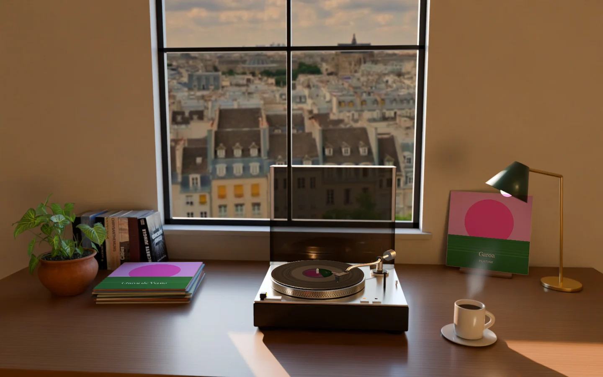
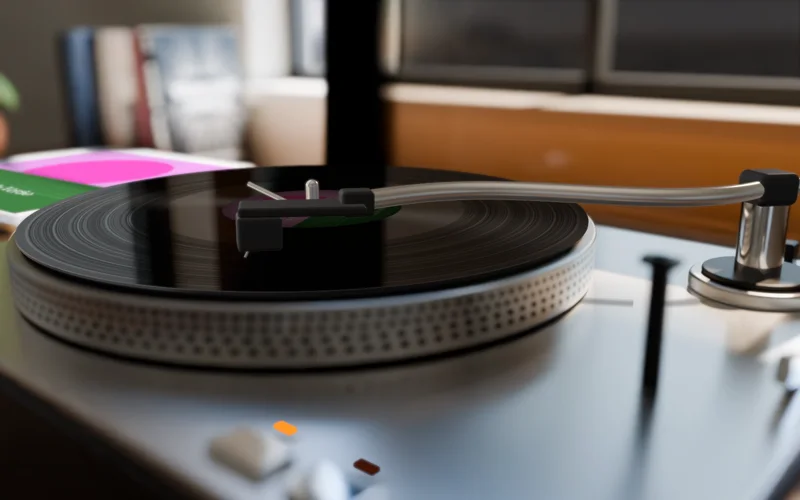
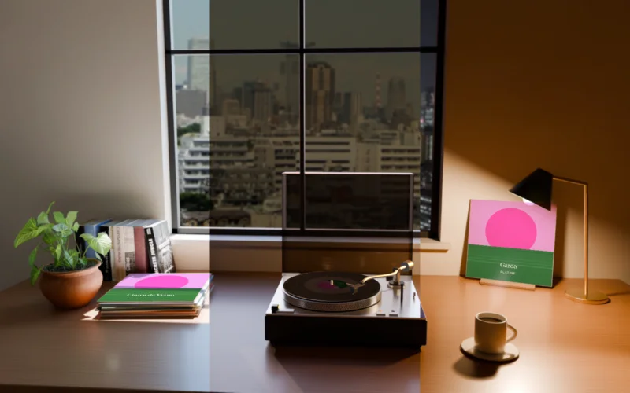
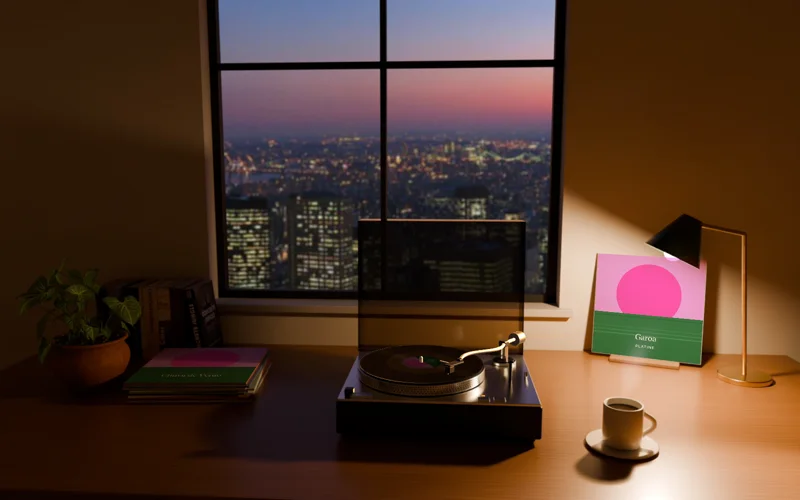
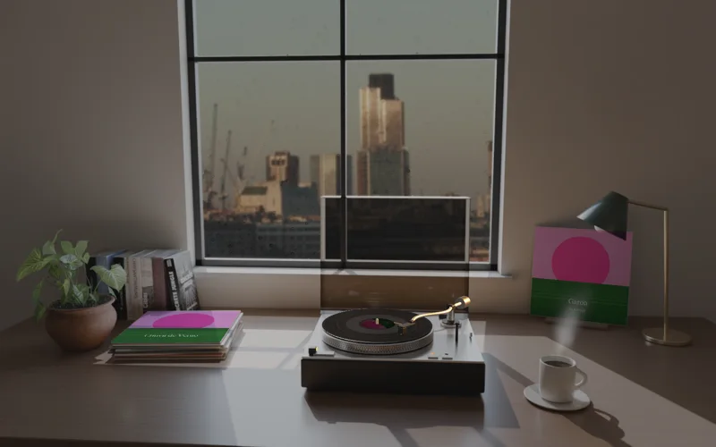
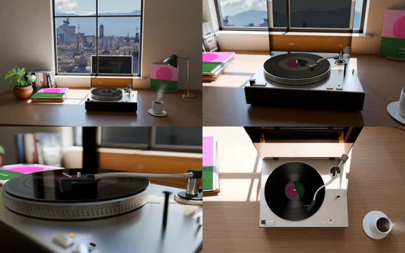
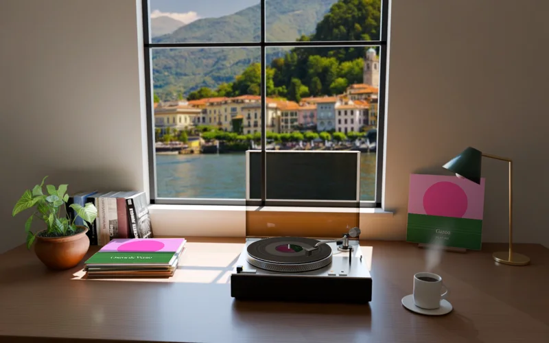

<div align="center">

# Platine

**Une platine sur ton bureau, qui joue ce que tu écoutes.**<br>
Un fond d'écran vivant pour macOS qui suit Spotify et Musique. Libre et gratuit.

<br>

<p></p>

<br>

<a href="https://github.com/adrbn/platine/releases/latest"></a>&nbsp;
<a href="#villes"></a>&nbsp;
<a href="#compiler"></a>&nbsp;
<a href="#comment-ça-marche"></a>

<br>

[](#configuration-requise)
[](#ce-quelle-fait)
[](#comment-ça-marche)
[](#vie-privée)
[](https://github.com/adrbn/platine/releases/latest)
[](LICENSE)

[English](README.md) · Français

</div>

---

**Platine** met une pièce derrière tes fenêtres : un bureau devant une fenêtre sur la
ville, une platine des années 70, un café, une pile de disques, une lampe pour le soir.
Lance un morceau dans Spotify ou Musique : l'album se pose sur le plateau, sa pochette sur
le support, le bras descend dans le sillon du morceau en cours. Passe au suivant, l'aiguille
se déplace. Mets en pause, le bras se lève.

La lumière suit ton horloge, de l'aube à la nuit, et s'il pleut dans ta ville, il pleut
sur la vitre. La pièce est rendue une fois dans Blender Cycles, avec une vraie lumière ;
seules les pièces qui bougent sont dessinées en direct, alors elle ne coûte presque rien.

## Ce qu'elle fait

<table>
  <tr>
    <td align="center" valign="top" width="33%"><br><b>Ton album, gravé pour de vrai</b><br><sub>Les sillons suivent la vraie liste des morceaux, chacun aussi large qu'il est long. Le bras se pose sur le morceau en cours et retourne le disque face B au bon moment.</sub></td>
    <td align="center" valign="top" width="33%"><br><b>Ton soleil</b><br><sub>Sept moments rendus dans Cycles, fondus en continu et calés sur le vrai lever et le vrai coucher du soleil chez toi. La lampe s'allume le soir.</sub></td>
    <td align="center" valign="top" width="33%"><br><b>Une ville derrière la vitre</b><br><sub>De vraies photos de 44 villes et 12 paysages, de jour et de nuit, toutes sous licence libre. Ou tape n'importe quel lieu, Platine en trouve une.</sub></td>
  </tr>
  <tr>
    <td align="center" valign="top"><br><b>Ta météo</b><br><sub>S'il pleut dans ta ville, il pleut sur la vitre : bruine, pluie ou averse, d'après Open-Meteo. Ou choisis-en une et garde-la.</sub></td>
    <td align="center" valign="top"><br><b>Quatre cadrages</b><br><sub>Large, moyen, serré sur le plateau avec une vraie profondeur de champ, ou vu de dessus.</sub></td>
    <td align="center" valign="top"><br><b>Ou ta propre vue</b><br><sub>Mets n'importe laquelle de tes photos, et règle son flou derrière la vitre, de nette à très loin dans le flou.</sub></td>
  </tr>
</table>

## Villes

La fenêtre donne sur l'une d'elles, au choix dans la barre des menus, sous **Through the window** :

<!-- CITIES -->
Alps · Amsterdam · Autumn Forest · Bangalore · Bangkok · Barcelona · Beijing · Berlin · Bogotá · Buenos Aires · Cairo · Cape Town · Chicago · Delhi · Dhaka · Dubai · Fjord · Guangzhou · Highlands · Ho Chi Minh City · Hong Kong · Istanbul · Jakarta · Kyoto · Lagos · Lake Como · Lima · Lisbon · London · Los Angeles · Madrid · Manila · Mediterranean · Mexico City · Moscow · Mumbai · New York · Osaka · Paris · Prague · Rice Terraces · Rio de Janeiro · Rome · Sahara · San Francisco · Seoul · Shanghai · Singapore · Snow Village · Sydney · São Paulo · Tehran · Tokyo · Toronto · Tropical Beach · Tuscany
<!-- /CITIES -->

Elle n'y est pas ? Tape-la quand même : Platine demande à [Openverse](https://openverse.org)
une photo libre de jour et une de nuit (CC0, domaine public, CC BY ou CC BY-SA), se rabat
sur le paysage alentour s'il n'y a pas de skyline, et les garde dans
`~/Library/Application Support/Platine/Cities`. **Another photo** essaie la suivante.
Le crédit de chaque photo s'affiche sous le champ de recherche.

Ou choisis **Use your own photo…** : une photo large marche le mieux, une vue, un paysage, une skyline.

## Télécharger

Prends `Platine.dmg` dans la [dernière release](https://github.com/adrbn/platine/releases/latest),
glisse-la dans Applications et ouvre-la. Elle vit dans la barre des menus, sans icône dans le Dock.

La première fois qu'un lecteur tourne, macOS demande si Platine peut lire ce qu'il joue :
réponds oui, c'est la seule chose qu'elle lit.

## Configuration requise

- macOS 14 Sonoma ou plus récent, Apple Silicon ou Intel
- Spotify ou Musique, pour que le disque suive

## Compiler

```bash
brew install xcodegen
make run          # build Debug, ouvert
make test         # tests : gravure du disque, géométrie du bras, mouvement de la platine, lumière
make install      # build Release → /Applications, signé avec ton Developer ID si tu en as un
```

Par défaut, les builds sont signés ad hoc : tout le monde peut cloner et compiler. Avec un
Developer ID Apple dans le trousseau, `make install` signe avec, et macOS garde la
permission d'automatisation d'un build à l'autre.

Pour vérifier la pièce sans toucher au bureau :

```bash
make snapshots    # chaque cadrage à quatre heures, dans docs/snapshots
```

### Refaire le rendu de la pièce

Les plans de `Sources/Platine/Resources/Plates` sortent de `render/room.py`, avec
[Blender](https://www.blender.org) 5 :

```bash
python3 render/fetch_assets.py                     # la plante et les livres, CC0 de Poly Haven
blender -b -P render/room.py -- --out render/out/final --size 2560x1600 --samples 64 --masks
swift render/to_heic.swift render/out/final Sources/Platine/Resources/Plates
```

Environ une heure et demie sur un M1. `render/cities.py` a servi à choisir les villes :
`search "Lagos" night` montre les candidates, `pick "Lagos" night 3` en garde une.

## Comment ça marche

```
Players     PlayerBridge   notifications de Spotify et Musique, lues en AppleScript (jamais lancés)
Record      LPLayout       la liste des morceaux gravée sur deux faces, au vrai pas de sillon
            TonearmGeometry · TurntableMotion   cinématique du bras et du plateau, pure et testée
Scene       Plates         plans Cycles par cadrage et par heure, fondus, la ville posée
                           derrière la vitre avec le flou de l'objectif
            RoomScene      SceneKit : le disque, le bras, la pochette, la vapeur et la pluie, en direct
            DayCycle · PlateSchedule   la lumière au fil de la journée
Wallpaper   DesktopController   une fenêtre transparente aux clics, au niveau du bureau, une par écran
            OcclusionDetector   pause quand le bureau est couvert, d'après la géométrie des fenêtres
```

La pièce est dessinée une fois, hors ligne, en lancer de rayons avec de vrais matériaux.
L'app mélange les deux plans les plus proches de ton heure, pose la photo de la ville dans
la fenêtre avec la profondeur de champ du cadrage, puis dessine par-dessus les pièces qui
bougent dans SceneKit, éclairées par une sonde de lumière rendue à l'endroit du disque.

## Vie privée

Pas de compte, pas de statistiques. Platine lit ce que Spotify ou Musique joue sur ton
Mac, et ne lance ni ne pilote jamais un lecteur. Elle demande une fois ta position
approximative, pour caler le soleil. Ces coordonnées ne partent que vers [Open-Meteo](https://open-meteo.com), pour
la pluie. Le nom d'un album part au catalogue public d'Apple quand le lecteur ne donne
pas de pochette, ou pour chaque album si tu actives **Look up track lists**. Chercher un lieu envoie son nom à Openverse.

## Feuille de route

- Un léger mouvement de la lumière à la fenêtre, au passage des nuages
- D'autres styles de pièce
- Un économiseur d'écran assorti

## Contribuer

Issues et pull requests bienvenues. Garde la pièce honnête : vraie géométrie, vraie
lumière, ressources sous licence libre avec leur crédit.

## Crédits

- Plante et livres : [Poly Haven](https://polyhaven.com), CC0
- Photos des villes : voir [CREDITS.md](CREDITS.md), chacune avec son auteur et sa licence
- Météo : [Open-Meteo](https://open-meteo.com)

## Licence

[MIT](LICENSE). Les photos des villes gardent leurs propres licences, listées dans
[CREDITS.md](CREDITS.md).
